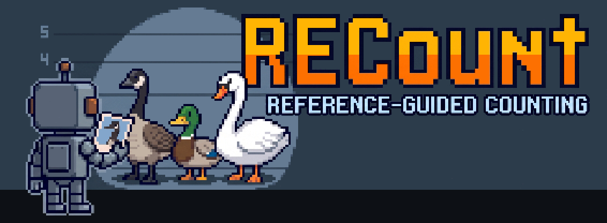

# RECount: Reference-Guided Counting with Synthetic Visual Exemplars
This repository is for sharing the code base used for the paper "RECOUNT: Reference-guided Counting with Synthetic Visual Exemplars", which was accepted to WACV2027
